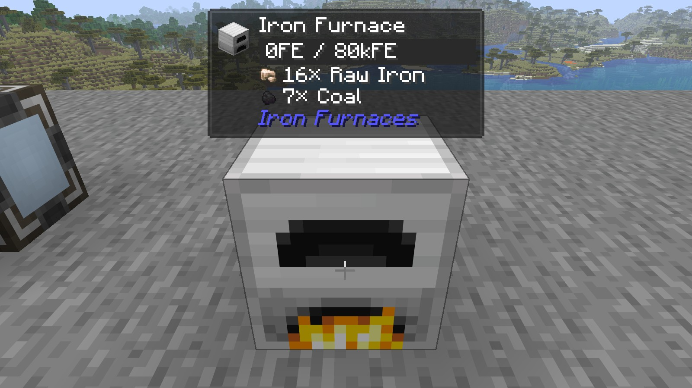

# Jade for Sunrise

Jade (Snownee, [CC BY-NC-SA 4.0](LICENSE)) as a native mod on Sunrise's mod API: Hooks only, no mixins and no
`[[inject]]`. It shows what you are looking at: the block, fluid or entity, its mod, its harvest tool, and what's inside.
An unofficial port; the code is a rewrite of Jade's logic on Sunrise's APIs. See `NOTICE` for credits.

- **Mod id** `jade`, **version** 26.3.8.
- **Game build:** pinned to the Sunrise Nightly of 2026-11-19, game commit
  `ed3ac19558d8dc1092c431312848cbb58fb01e41` (`nightly-2026-11-19-ed3ac19`), Minecraft 26.3. The launcher compiles the
  mod against that build's prebuilt game; a newer Nightly needs a repinned release.
- **Install:** in Sunrise's launcher, Mods › Add from GitHub with this repository, or put the release's
  `jade-26.3.8.smod` in an instance's mods. Native code is not sandboxed: the launcher asks you to trust it.
- **Licence:** CC BY-NC-SA 4.0, like Jade itself: free to use and share, not for commercial use, and changes are
  shared under the same licence.

## What it does

- **The overlay** for blocks, fluids and entities: title, icon, harvest tool, mod name, breaking progress, containers'
  contents and energy, and other mods' lines (through the provider API below). Lite mode, extended reach, ignore
  lists, scale, position, opacity and fade, as in Jade.
- **Themes:** Jade's seven and any a resource pack adds (`assets/<ns>/jade_themes/**.json`).
- **Config screens and profiles:** the four screens, search, profiles #0 to #3 (`config/jade/profile-<n>.json`).
- **Keys** (Controls, category Jade): Open Config, Show Overlay, Toggle Fluid, Show Recipes, Show Uses, Narrate, Show
  Details, Use Profile #0 to #3.
- **Commands:** `/jadec config | pin | handlers | use_profile <n> | generate_server_overrides` (client),
  `/jade show|hide` (operators), and the game rule `jade:max_position_deviation`.
- **Multiplayer safety:** the server answers only for blocks and entities in the player's level and reach, caps the
  size and rate of requests, keeps command blocks' commands and loot tables to operators, and shows a locked container
  as locked.

## For other mods

Jade's provider API is in `src/api.rs`: a mod adds lines for its own blocks and entities.

## Build

`cargo sunrise-mod build` in this folder makes `target/sunrise-mod/jade.smod`.
